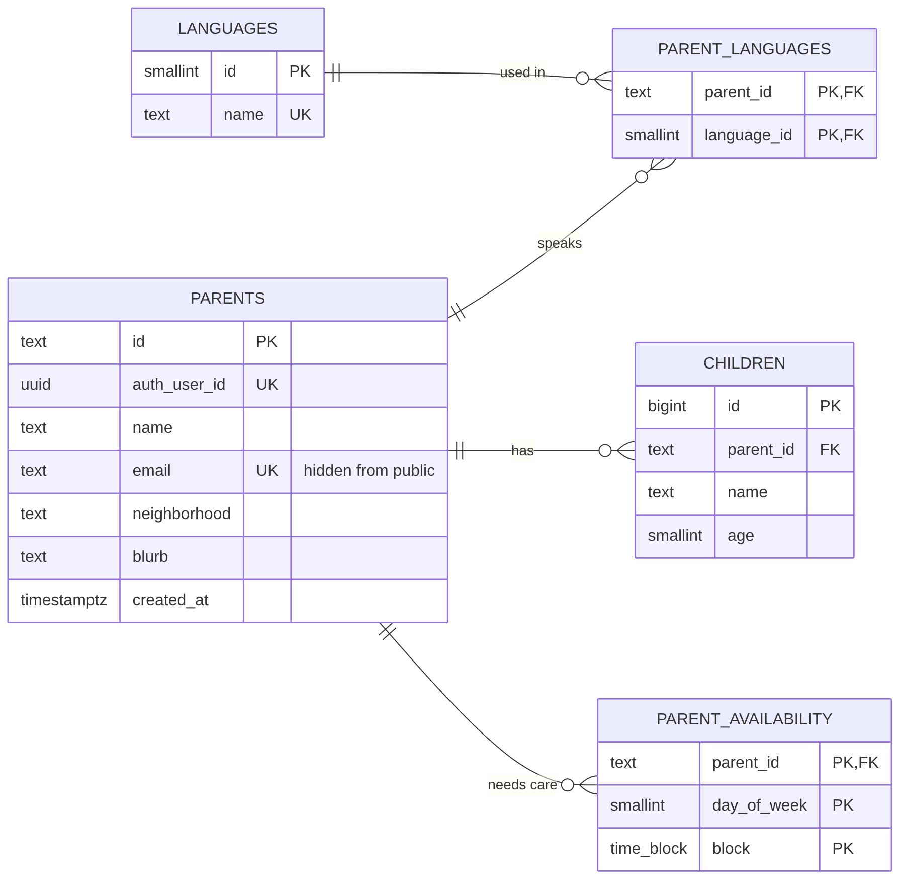
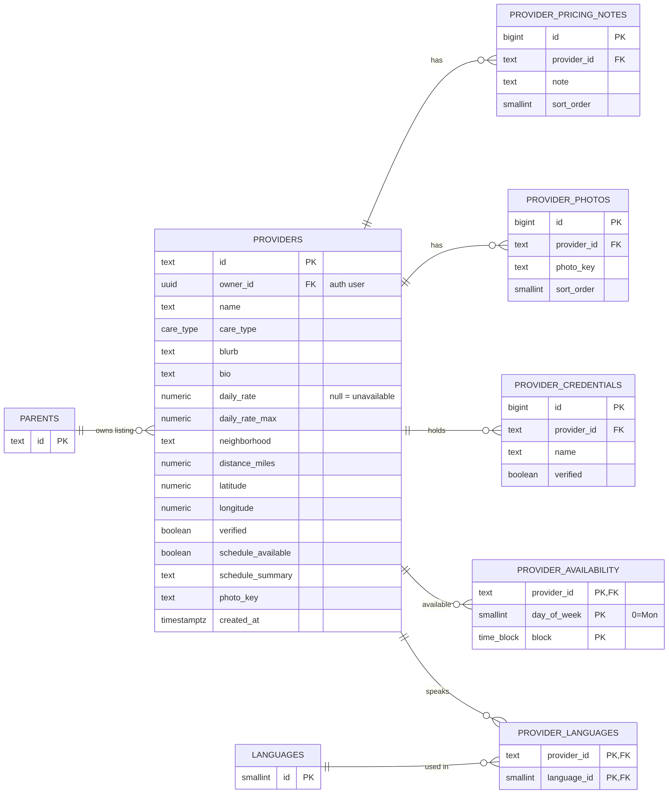
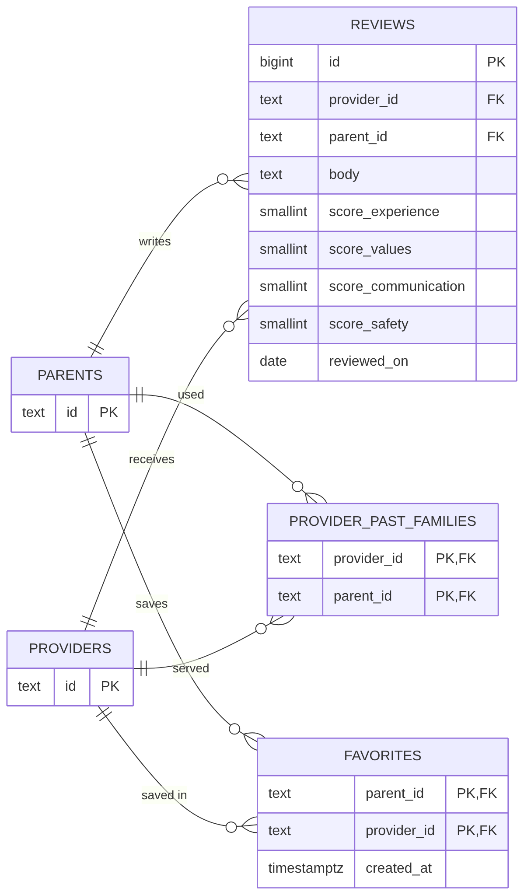
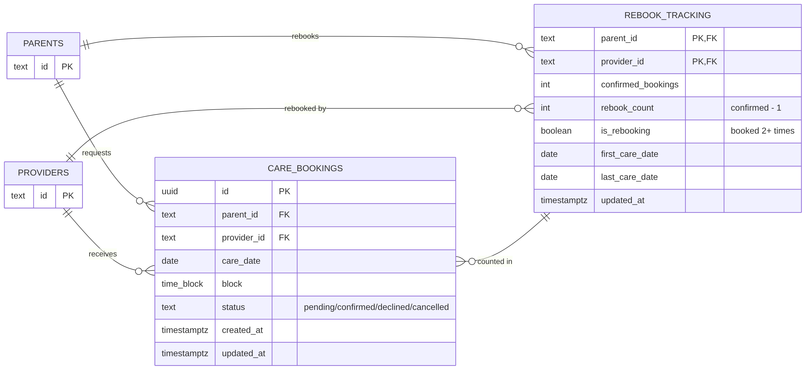
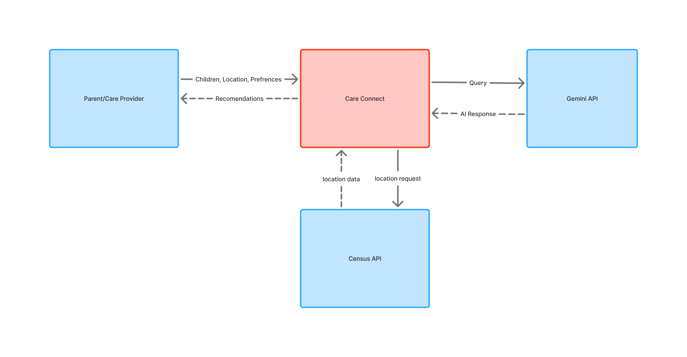
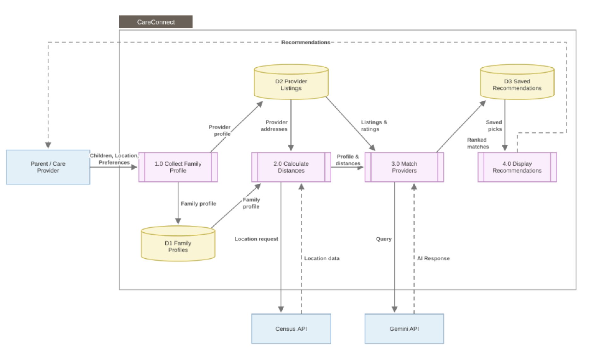

# CareConnect

**Live app:** https://pixel-perfect-magic-622.lovable.app
**Lovable project:** https://lovable.dev/projects/552dad75-fe91-4c90-bc61-ccab099dda72

## App Summary

Parents struggle to find child care that fits their family's specific needs because the options are scattered across provider websites, listings, and word-of-mouth recommendations. Every family weighs things differently: some need care that adapts to a constantly changing work schedule, some are priced out or surprised by extra fees, and some care most about trusting the people watching their children. The people who feel this most are working parents — especially shift workers, first-time parents, and bilingual households — who have to compare daycares, preschools, sitters, and family friends by hand. CareConnect puts price, schedule, and trust in one place. Parents filter providers by care type, price, distance, rating, verification, and language, and see each provider's daily cost (or a clear "pricing unavailable"). They save the hours they need care in a weekly calendar and the app shows exactly where a provider's availability overlaps or leaves gaps. Parents can read and write detailed ratings, save favorites and compare two or three side by side, and request dated care blocks that providers confirm, while caregivers can publish their own listing.

## ERD

The product data model has 16 tables. To keep it readable, the ERD is split into four diagrams by feature. Together they show every product table, every attribute, and every labeled relationship. Login totals are tracked in the internal `user_login_counts` table; users cannot read it. A table drawn with only its `id` is detailed in another diagram. Click any image to open it full size.

**Key:** `PK` primary key · `FK` foreign key · `UK` unique · `||--o{` one-to-many (one on the bar side, zero-or-many on the crow's-foot side)

### 1. Parents and families
Parent profiles, their children, languages, and the weekly hours they need care.

<a href="docs/erd-1-parents.png"></a>

### 2. Providers
Provider listings with price, schedule, languages, photos, licenses, and the user who owns the listing.

<a href="docs/erd-2-providers.png"></a>

### 3. Trust and saving
Reviews with four detailed scores, families who have used a provider, and saved favorites.

<a href="docs/erd-3-trust.png"></a>

### 4. Bookings and rebooking
Dated care requests that a provider confirms or declines, and the rebooking tracker built from them (OKR 2). `REBOOK_TRACKING` has no foreign key to `CARE_BOOKINGS`; a database trigger recalculates it whenever a booking changes.

<a href="docs/erd-4-bookings.png"></a>

**Full diagram:** all 16 product tables on one page are in [docs/erd.png](docs/erd.png) (zoom in to read). Diagram sources are the `docs/*.mmd` Mermaid files, and the SQL that builds the database is [`supabase/setup.sql`](supabase/setup.sql) plus the files in [`supabase/migrations/`](supabase/migrations).

## Tech Stack

| Layer | What we used | Why it fits our team |
| --- | --- | --- |
| Frontend | React 19, TanStack Start + TanStack Router (file-based routes in `src/routes`), Tailwind CSS | Lovable generates this stack, so we could design screens quickly with prompts and still edit the code by hand. File-based routes make it easy for each teammate to own a page. |
| Data fetching | TanStack Query + `@supabase/supabase-js` | Caches database reads and refreshes them after every save, so the UI updates instantly without us writing a backend API. |
| Database | Supabase Postgres with Row Level Security | A real relational database that matches our ERD. Security rules live in the database, so users can only change their own data. |
| Authentication | Supabase Auth (email + password) | Sign-up, login, and password reset with no extra service. New sign-ups automatically get a parent profile through a database trigger. |
| Hosting / workflow | Lovable (build + hosting), GitHub (source of truth) | Pushing to `main` syncs to Lovable and anyone on the team can publish. Everyone can work in the Lovable editor or locally in GitHub. |

## Data Flow Diagrams

### Level 0 Data Flow Diagram


### Level 1 Data Flow Diagram


## How to Get It Running

### Option A — Use the hosted app (no setup)

1. Open the live app: https://pixel-perfect-magic-622.lovable.app
2. Click **Create account**, fill in your name, email, password, children, and the weekly hours you need care, then submit.
3. If email confirmation is on, click the link in the confirmation email, then log in.
4. To edit the project, open the [Lovable project](https://lovable.dev/projects/552dad75-fe91-4c90-bc61-ccab099dda72) (ask a teammate for access). Click **Publish → Update** in Lovable to push the latest `main` to the live site.

### Option B — Run it from a fresh copy of the code

You need [Node.js](https://nodejs.org) 20+ and npm.

```sh
git clone https://github.com/IS-Junior-Core-3-5/CareConnect.git
cd CareConnect
npm install
npm run dev
```

Open the local URL that Vite prints in the terminal. The repo's `.env` already points at our Supabase project:

```
VITE_SUPABASE_URL=https://lhjzcxvyyvxdywwvjoyv.supabase.co
VITE_SUPABASE_PUBLISHABLE_KEY=sb_publishable_...
```

(The publishable key is safe to be public; Row Level Security protects the data.)

### Admin access

The `/admin` page is limited to accounts whose Supabase `app_metadata` contains `"role": "admin"`. Unlike `user_metadata`, users cannot edit `app_metadata` themselves, so an account cannot make itself an admin.

#### Create an admin user

1. **Create the account normally.** Sign up through the app (**Create account**), or add the user in the Supabase dashboard under **Authentication → Users → Add user**. The account is a regular parent account until step 2.
2. **Grant the admin role.** The dashboard's user editor does not always expose `app_metadata`, so the reliable way is the SQL editor. Open **SQL Editor → New query** in the Supabase dashboard for your project ([team project shortcut](https://supabase.com/dashboard/project/lhjzcxvyyvxdywwvjoyv/sql/new)) and run this, replacing the email with the admin account's email:

   ```sql
   update auth.users
   set raw_app_meta_data =
     coalesce(raw_app_meta_data, '{}'::jsonb) || '{"role":"admin"}'::jsonb
   where email = 'admin@example.com';
   ```

   Run it once per admin account. The `||` merges the new key into any metadata that is already there instead of replacing it.

3. **Verify the role.** Run:

   ```sql
   select email, raw_app_meta_data
   from auth.users
   where email = 'admin@example.com';
   ```

   The result should include `"role": "admin"`, for example:

   ```json
   { "provider": "email", "providers": ["email"], "role": "admin" }
   ```

4. **Sign out and back in.** The role is carried in the user's JWT, which is issued at login. An existing session will not see the new role until it refreshes, so sign out of the app and log back in.

After that, the account lands on `/admin` after logging in and sees an **Admin** link in the navigation. Other accounts get an "Admins only" message if they open the page directly.

To **remove** admin access, run the same update with the role removed:

```sql
update auth.users
set raw_app_meta_data = raw_app_meta_data - 'role'
where email = 'admin@example.com';
```

#### Enforcing admin access in the database

The client check only controls what the UI shows. The admin migrations enforce the same role in Postgres and provide the panel's data access:

- [`20261111000000_admin_foundation.sql`](supabase/migrations/20261111000000_admin_foundation.sql) adds `public.is_admin()`, the provider admin view and stats, provider moderation, and the audit log.
- [`20261112000000_admin_bookings.sql`](supabase/migrations/20261112000000_admin_bookings.sql) adds admin read access to bookings, the booking list view, and the audited status RPC.
- [`20261113000000_admin_parents.sql`](supabase/migrations/20261113000000_admin_parents.sql) adds the admin-only family list and family detail functions.
- [`20261113000001_fix_admin_parents_ambiguity.sql`](supabase/migrations/20261113000001_fix_admin_parents_ambiguity.sql) fixes an ambiguous-column error in the family list function. Apply it after the first parents migration.
- [`20261114000000_admin_ai.sql`](supabase/migrations/20261114000000_admin_ai.sql) adds the admin AI recommendation overview, detail, and clear-set functions.

Key objects:

- `public.is_admin()` returns true when `(auth.jwt() -> 'app_metadata' ->> 'role') = 'admin'`.
- `admin_provider_list`, `admin_booking_list`, and `admin_dashboard_stats()` return rows only to admins.
- `admin_parent_list()` and `admin_parent_detail(...)` are security-definer functions that return private family data only to admins.
- `admin_ai_list()` and `admin_ai_detail(...)` return saved recommendation sets and AI usage counts only to admins.
- `admin_set_provider_flags(...)` and `admin_set_booking_status(...)` are security-definer RPCs for verify/publish and booking resolution.
- `admin_clear_ai_recommendations(...)` clears a family's cached matches so they regenerate on the next visit.
- `admin_audit_log` records every admin write.

Apply the admin migrations in the SQL editor after the earlier migrations, then reload `/admin`. Until they are applied, the affected sections show a database error.

The Parents section is read-only. It exposes parent emails, private addresses, children, schedules, preferences, favorites, and booking history only through the admin-guarded functions. Normal authenticated users still cannot read `parents.email` or the private family tables directly. The **Export CSV** button downloads that private data, so treat exported files as sensitive and delete them when they are no longer needed.

The AI recommendations section is also admin-only. It shows saved matches, the AI's explanations, and chat usage counts, but **not** chat message content. **Clear matches** deletes only the cached recommendation set so the family gets a fresh one on their next visit; chat history is untouched. That action is recorded in `admin_audit_log`.

The admin panel currently has:

| Section | Status | What it does |
| --- | --- | --- |
| Overview | Available | Provider, family, booking, and AI counts, plus a **Needs attention** list |
| Providers | Available | Search and filter listings, verify providers, and publish or archive them |
| Bookings | Available | Review the pending queue, resolve stuck requests, and track rebooking |
| Parents | Available | Read-only family support view with contact, children, schedule, preferences, bookings, and CSV export |
| AI recommendations | Available | Review saved matches and chat usage, see why providers were chosen, and clear stale sets |

### Option C — Use your own Supabase database

1. Create a project at [supabase.com](https://supabase.com).
2. In the Supabase dashboard, open **SQL Editor → New query**, paste all of [`supabase/setup.sql`](supabase/setup.sql), and click **Run**. This creates the tables, demo data, the sign-up trigger, and the security rules. Then run each file in [`supabase/migrations/`](supabase/migrations) the same way, in filename order. The migrations add care bookings, rebooking and AI recommendation tracking, per-user login counts, privacy hardening (children, parent auth ids, family schedules, favorites and past families are private), provider-favorite discovery timing, the admin foundation, admin booking moderation, the admin family support view, and the admin AI recommendation review. If you are updating an existing project, only run migrations you have not applied yet — re-running an old one fails because its tables already exist. Never run `setup.sql` on a database with real users: it deletes and rebuilds the tables.
3. In **Project Settings → API**, copy the Project URL and the publishable key into `.env` as `VITE_SUPABASE_URL` and `VITE_SUPABASE_PUBLISHABLE_KEY`.
4. In **Authentication → URL Configuration**, set **Site URL** to where the app runs (e.g. your local URL or your Lovable URL) and add it under **Redirect URLs**. For quick testing, turn off **Confirm email** under **Authentication → Sign In / Providers → User Signups**.
5. Run `npm run dev`.

## Updating a Live Project

`main` is the source of truth, but three things deploy separately:

1. **Publish the app in Lovable** — open the [Lovable project](https://lovable.dev/projects/552dad75-fe91-4c90-bc61-ccab099dda72) and click **Publish → Update**. Lovable builds from `main`.
2. **Redeploy the `recommend-providers` edge function** — Lovable and GitHub do not deploy Supabase Edge Functions. Either paste [`supabase/functions/recommend-providers/index.ts`](supabase/functions/recommend-providers/index.ts) into **Edge Functions → recommend-providers** in the Supabase dashboard, or run:

   ```sh
   npx supabase login
   npx supabase functions deploy recommend-providers --project-ref lhjzcxvyyvxdywwvjoyv
   ```

   A redeploy keeps the existing `GEMINI_API_KEY` secret.
3. **Run only the migrations you have not applied yet**, in filename order, in the Supabase SQL Editor. Re-running an old migration fails because its tables already exist.

**Order matters for privacy migrations.** `20261103030000_hide_parent_auth_ids.sql` removes a column that the old frontend and edge function still read, so publish the app and redeploy the function *before* running it. `20261103040000_private_family_activity.sql` only removes anonymous read access and is safe to run once the app is published.

## Verifying the Vertical Slice

The vertical slice is the **Add to favorites** button: UI → Supabase `favorites` table → back to the UI.

1. Log in (or create an account) on the live app.
2. Click **Trusted Providers** in the top navigation.
3. On any provider card, click the empty heart **♡**.
   - The heart turns solid **♥**.
   - A "Saved to favorites" message appears.
   - The **Favorites** link in the navigation shows the new count.
4. **Refresh the page** (Ctrl/Cmd + R). The heart is still **♥** and the count is unchanged.
5. Click **Favorites** in the navigation. The provider is listed there, and is still there after another refresh.
6. To prove it is saved in the database (not just the browser), do one of these:
   - Log in with the same account in a different browser or private window. The favorite is there.
   - In Supabase, open **Table Editor → favorites**. There is a row with your parent id and that provider's id.
7. Click the heart again to remove it, then refresh. The heart stays empty and the row is gone from the table.

Other actions that also save and survive a refresh: editing your schedule (**Schedule** page), editing your profile and children (**Profile** page), writing a review on a provider's profile, and creating a provider listing on **My listing**.

## AI Assistant and AI Preferences

- **AI chat** (on the Home page and the **Ask AI** button in the bottom-left corner of every signed-in page): ask questions or for specific recommendations. Replies show cards for the providers mentioned. History is stored in `ai_chat_messages` (each parent sees only their own).
- **AI preferences** (`/preferences`, linked from **Profile**): an in-depth, private profile the AI uses for both the chat and the Home page recommendations. It covers care type, setting and arrangement, start date, budget range and how firm it is, preferred cities and max distance, transportation, must-haves and dealbreakers, teaching approach, caregiver languages, kids' needs and diet, communication, ranked priorities, free-form notes, and answer length. Stored in `parent_preferences`, one row per parent, with row-level security so only the owner can read or edit it.
- Both run through the `recommend-providers` Edge Function (Google Gemini). Must-haves and dealbreakers are treated as hard filters, and priorities set the weighting.

**Verify:** sign in → **Profile → AI preferences** → pick e.g. Preschool, Montessori, Lindon, priority "Teaching approach" first, answer style Short → **Save preferences** → open **Ask AI** → ask "Based on my preferences, which provider should I look at first?" The reply should be short and pick a provider that matches (e.g. a Montessori preschool in Lindon), with a provider card. In Supabase, `select * from parent_preferences;` shows the saved row.

## OKR 2: Rebooking Tracker

**Goal:** show whether families keep coming back to the same provider.

**Table:** `rebook_tracking` — one row per family + provider pair.

| Column | Meaning |
| --- | --- |
| `confirmed_bookings` | How many of this family's bookings with this provider were confirmed |
| `rebook_count` | Times they came back after the first booking (`confirmed_bookings − 1`) |
| `is_rebooking` | `true` once a family has booked the same provider 2+ times |
| `first_care_date` / `last_care_date` | Their first and most recent confirmed care dates |

**How it updates:** automatically. A trigger on `care_bookings` recalculates the pair whenever a provider confirms a request or a family cancels one. Pending and declined requests don't count. Nobody can edit the table by hand, and each user can only read rows for their own family or their own listing.

**Summary views:**
- `provider_rebook_rates` — per provider: families booked, families who rebooked, and the rebook rate (%).
- `parent_rebook_summary` — per family: providers booked, providers rebooked, and total rebookings.

**Check it** in Supabase → **SQL Editor**:

```sql
-- Which providers do families come back to?
select provider_name, families_booked, families_rebooked, rebook_rate_pct
from provider_rebook_rates
where families_booked > 0
order by rebook_rate_pct desc;

-- Overall rebook rate across the app
select round(100.0 * count(*) filter (where is_rebooking) / nullif(count(*), 0), 1) as overall_rebook_rate_pct
from rebook_tracking;
```

### Verifying OKR 2

A rebook counts when the **same family** books the **same provider** on **2 or more dates** and the provider **confirms** each booking.

**Option 1: through the app (two accounts)**

1. **Provider account:** sign up, go to **My listing**, keep **Show my schedule** checked, select some blocks (e.g. Mon–Fri mornings), and click **Publish listing**. Sign out.
2. **Parent account:** sign up or log in as a different user. Open the provider's page from **Trusted Providers**. Under **Request a care block**, send two requests for two different future dates in a block the provider offers (e.g. two Mondays, Morning). Sign out.
3. **Provider account:** log in, go to **Schedule → Care requests**, and click **Confirm** on both.
4. In Supabase → **SQL Editor**, run:

   ```sql
   select p.name as parent, pr.name as provider,
          r.confirmed_bookings, r.rebook_count, r.is_rebooking
   from rebook_tracking r
   join parents p on p.id = r.parent_id
   join providers pr on pr.id = r.provider_id;
   ```

   Expected: `confirmed_bookings = 2`, `rebook_count = 1`, `is_rebooking = true`.
5. Optional: as the parent, **Cancel** one booking and run the query again. It drops to `confirmed_bookings = 1`, `is_rebooking = false`.

**Option 2: database-only test (nothing is saved)**

Run this in Supabase → **SQL Editor**. It creates a test provider and parent, books the same provider three times, confirms, shows the result, then rolls everything back.

```sql
begin;
insert into auth.users (id, instance_id, aud, role, email, raw_user_meta_data, created_at, updated_at) values
 ('aaaaaaaa-0000-0000-0000-0000000000a1','00000000-0000-0000-0000-000000000000','authenticated','authenticated','okr-provider@example.com','{"name":"OKR Provider"}', now(), now()),
 ('aaaaaaaa-0000-0000-0000-0000000000a2','00000000-0000-0000-0000-000000000000','authenticated','authenticated','okr-parent@example.com','{"name":"OKR Parent"}', now(), now());
update providers set owner_id = 'aaaaaaaa-0000-0000-0000-0000000000a1' where id = 'maya-okafor';

-- parent books Maya for the next 3 Monday mornings
set local role authenticated;
select set_config('request.jwt.claims', '{"sub":"aaaaaaaa-0000-0000-0000-0000000000a2","role":"authenticated"}', true);
insert into care_bookings (parent_id, provider_id, care_date, block)
select my_parent_id(), 'maya-okafor', d, 'Morning'
from (select (current_date + ((8 - extract(isodow from current_date)::int) % 7) + 7*g)::date d
      from generate_series(0, 2) g) x;

-- provider confirms them
select set_config('request.jwt.claims', '{"sub":"aaaaaaaa-0000-0000-0000-0000000000a1","role":"authenticated"}', true);
update care_bookings set status = 'confirmed' where provider_id = 'maya-okafor' and status = 'pending';

select r.confirmed_bookings, r.rebook_count, r.is_rebooking,
       (select rebook_rate_pct from provider_rebook_rates where provider_id = 'maya-okafor') as maya_rebook_rate
from rebook_tracking r;
rollback;
```

Expected: `confirmed_bookings = 3`, `rebook_count = 2`, `is_rebooking = true`, `maya_rebook_rate = 100.0`.

The SQL that creates the tracker is in [`supabase/migrations/20261102000000_rebook_tracking.sql`](supabase/migrations/20261102000000_rebook_tracking.sql).

## Vertical Stack Demo
[CareConnect Vertical Stack Demo](https://youtube.com/watch?v=2-67DQt3WOw)
